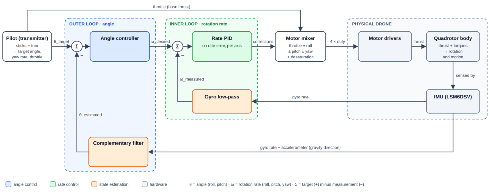
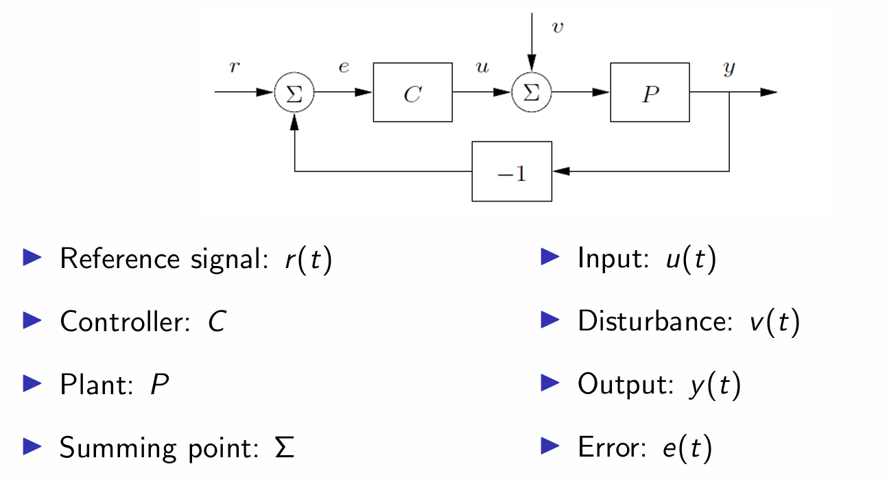

# QuadCtrl - A QuadRotor Device Making Avionics and Flight-Control Education Accessible
QuadCtrl is a ~$30 educational micro-quadcopter designed to teach embedded flight control from the ground up. An ESP32-S3 flight controller fuses LSM6DSV IMU data with a complementary filter and runs a cascaded angle → rate PID loop at 500 Hz to drive four 8520 brushed motors. A custom ESP-NOW transmitter with an OLED display and potentiometers lets you tune PID gains live in flight. A VL53L0X/VL53L1X time-of-flight sensor adds altitude hold, and optical flow and UWB positioning are planned for autonomous flight without motion capture.

 
The base drone consists of:

* 4 8520 DC Brushless Motors w/ 75mm Propelllers
* A 1S LiPo battery - 5-7 minutes of run time.
* A 6-axis accelerometer/gyro sensor. 
* A microcontroller (ESP32s) to communicate with hardware and sensors.
* 75 grams
* 3D-Printed Motor Mount Frame

 
This robot was inspired by the UCSD course, CSE 176E/276E, taught by Professor Steven Swanson, with the goal being to streamline the design around the EnVision Maker Studio's ESP32S3 DevBoard.
 

- - -

 

## Drone in action:

- - -

 

## Electronics:
 
Below is an image of the drone schematic, with an explanation of the purposes of most components:

* NMOS acts like a voltage controlled switch, so that when Pin 4 writes HIGH, NMOS turns on which allows current to flow through the motor. 

* Pull down resistor is to hold the MOSFET off when the gate isn’t being driven.

* Flyback diode is there to protect the motors, since motors are a coil, like inductors, they resist sudden changes in current, think how the current of an inductor can’t change instantaneously! So the current in the motor wants to keep flowing even if the NMOS has turned off which means no current flow, with the diode, the current flows through the diode and back into the motor so it slowly dies out safely without feeding back into the NMOS and destroying it. (Because of how fast the mosfets can switch on and off, a schottky diode is recommended and used here because those are able to switch very fast)

* Bulk capacitor (220uF) is there since motors draw a large amount of current when they turn on, which might make the battery supply dip in voltage since they can’t supply that amount instantaneously, so the bulk caps here help supply that burst locally

* Bypass capacitor (1uF) is here so that any high frequency electrical noise here created from the motors is shorted to ground and gets smoothed out

  

- - -

 

## Flight Algorithm:

Here is a surface-level explanation of the current flight algorithm, to understand this, it would be helpful to have some basic understanding of feedback control/control theory, but hopefully my explanation will make sense regardless:

Here was my original base flight algorithm, before the ToF sensor: 

Now to start, let's first define what a typical feedback system looks like:

* The reference signal r(t), is what our desired output is, for example a desired position.
* That gets put into a summing-node with the measurement of a feedback sensor to get our error, essentially e(t) = (desired - actual).
* The error, e(t) then becomes the input into our control algorithm.
* Our control algorithm then sends an output to our actuators, i.e., in our case, the drone control algorithm factors in to how much/how long the motors should spin, where the actuators are our motors.
* The actuator output then becomes the input to our plant, and our plant is the drone (plant is just what we refer to as being controlled, and that has its own instrinsic properties)
* The output of the plant then becomes whatever is the current thing we are measuring, for example speed, position, etc., which then gets measured by our sensors and is fed back into the summing node for our reference signal until the desired output is reached, so that e(t) = 0

So, how do we measure the orientation of our quadcopter to maintain levelness, or even start moving around? 

To get an estimate of the angle our drone is at, we start with our IMU which measures acceleration in x, y, z axis + gravity to tell which way is down, and Gyroscope is for yaw, pitch, and roll, currently, with this setup, yaw is for rotation about the z axis, pitch is for rotation about the x axis, and roll is for rotation about the y axis, and the gyroscope is measuring how fast the drone is rotating each axis

Currently, when booting up the drone, the IMU calibrates for a standard “level” measurement for the gyroscope, i.e., place the drone down and leave it still so that it can calibrate for a measurement to achieve, since the readings afterwards subtracted from the offset based on the readings from at rest so it can tell when the drone is level

Afterwards, when the drone is in the air, the IMU is continuously measuring for the change in attitude for the drone, so that it can correct itself 500 times per second::

* 1) First, the gyroscope and accelerometer readings are passed through a low-pass filter in order to reduce the noise from the motor vibrations 
The attitude (the vehicle’s orientation), is then estimated by taking into account both the gyro and accelerometer readings, since 
if we take into account the gyro rotation rate, we can get an estimate of the current angle the drone is at, i.e., think about how if you know your velocity, you can integrate that to get position, i.e. x(t)=x(0)+0tv(t)dt, this is the exact same concept for the gyroscope in that the gyroscope measures angular rate in degrees/sec (t)=(0)+0t(t)dt, however, the weakness of this is that it over time, any small error can get added up, since we are essentially “adding up” over time
** At rest, the accelerometer only feels gravity pointing down, so when the drone tilts, that gravity force is then split across the axis, and with trigonometry we can turn that back into an angle, however, the weakness of this alone is that you CAN’T trust the accelerometer readings for short timescales, since if the drone is accelerating sideways, the drone’s acceleration mixes in with the gravity force, leading to the drone to think it’s tilting heavily. 
** A complementary filter adds both readings (with a weighted factor) to get an estimate of the attitude, as each loop we predict the angle from part a) with the gyroscope, and then the drone is slowly nudged into the downwards angle given by the accelerometer in part b, with a “weighted factor” since before time =2s(in code), we rely mostly on the gyroscope readings since the estimate is smooth and it ignores vibration and acceleration, and drift would only grow with a factor of t, however, past time , we then mostly rely on the accelerometer’s readings since if a drift has built up, we can nudge the estimate back (not the drone itself) based on the gravity angle, BUT BOTH PLAY A FACTOR FOR ALL TIME, NOT LIKE A HAND OFF. 

The limitation of this IMU for position holding is that IMUs can NOT accurately hold position on their own, we are able to correct for any deviations in “levelness” of the drone, since gravity always points down, allowing us to use the accelerometer to pull the gyroscope angles back towards “level”; however, there is no outside reference for the accelerometer, since nothing tells us where we are, and the IMU does not know where in the room we are. Furthermore, we have to integrate the acceleration to get position twice, meaning that drift will grow with a factor of t2.

  

- - -

