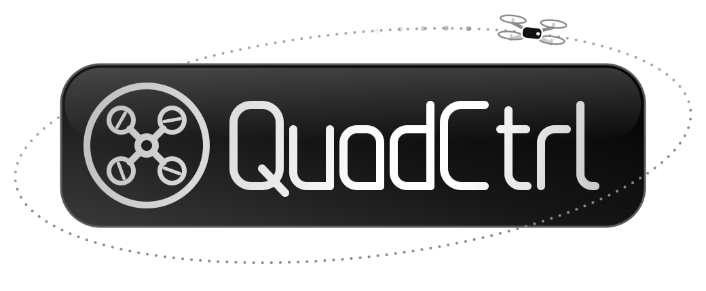

  <picture>
    <source media="(prefers-color-scheme: dark)" srcset="./images/quadctrl_logo_black.svg">
    
  </picture>

**A low-cost micro-quadcopter that makes avionics and flight-control education accessible.**

QuadCtrl is a ~$30 educational micro-quadcopter designed to teach embedded flight control from the ground up. An ESP32-S3 flight controller fuses LSM6DSV IMU data with a complementary filter and runs a cascaded angle → rate PID loop at 500 Hz to drive four 8520 brushed motors. A custom ESP-NOW transmitter with an OLED display and potentiometers lets you tune PID gains live, in flight. A VL53L0X/VL53L1X time-of-flight sensor adds altitude hold, and optical flow and UWB positioning are planned for autonomous flight without motion capture.

  
  

  

---

## Contents

- [Features](#features)
- [Hardware](#hardware)
- [Electronics](#electronics)
- [Flight Control Algorithm](#flight-control-algorithm)
  - [1. Feedback Control Basics](#1-feedback-control-basics)
  - [2. Attitude Estimation](#2-attitude-estimation)
  - [3. Pilot Commands and Motor Mixing](#3-pilot-commands-and-motor-mixing)
  - [4. Cascaded PID Control](#4-cascaded-pid-control)
  - [5. Altitude Hold](#5-altitude-hold)
- [Roadmap](#roadmap)
- [Acknowledgments](#acknowledgments)

---

## Features

- **500 Hz cascaded PID control**: an outer angle loop feeds an inner rate loop on roll and pitch, with heading hold on yaw
- **Complementary-filter attitude estimation**, with low-pass filtering on the gyro and accelerometer
- **Custom ESP-NOW transmitter** with live PID tuning (potentiometers), flight trim, an OLED telemetry display, and arming safety
- **Altitude hold** using a downward-facing time-of-flight sensor fused with the accelerometer
- **Safety features**: link-loss failsafe (auto-land in altitude mode), attitude cutoff, low-battery monitoring, and throttle-low arming
- **Low cost and simple to build**: off-the-shelf parts, a custom shield PCB, and a 3D-printed frame

## Hardware

| Component | Details |
|---|---|
| Microcontroller | ESP32-S3 dev board (EnVision Maker Studio) with a custom drone shield |
| IMU | LSM6DSV 6-axis accelerometer + gyroscope (I²C) |
| Motors | 4 × 8520 coreless brushed DC motors |
| Propellers | 75 mm |
| Battery | 1S LiPo (660 mAh), roughly 5–7 minutes of flight |
| Height sensor | VL53L0X / VL53L1X time-of-flight (auto-detected) |
| Frame | 3D-printed motor-mount frame |
| Weight | ~75 g |
| Radio | ESP-NOW (2.4 GHz) to a custom ESP32-S3 transmitter |

---

## Electronics

The full shield schematic is available here: [ECE193HQuadCopterShieldSchematicV1.pdf](./images/ECE193HQuadCopterShieldSchematicV1.pdf)

Each motor is driven by a low-side MOSFET switch. The key components are:

- **N-channel MOSFET**: acts as a voltage-controlled switch. When the ESP32 drives the gate HIGH (e.g. GPIO 4), the MOSFET turns on and current flows through the motor. Motor speed is set by the PWM duty cycle (20 kHz).
- **Gate pull-down resistor (10 kΩ)**: holds the MOSFET off whenever the gate is not being actively driven, such as during boot or reset, so the motors cannot spin unexpectedly.
- **Flyback diode (Schottky)**: a motor winding is an inductor, and its current cannot change instantaneously. When the MOSFET switches off, the diode gives that current a safe path to circulate back through the motor and decay. Without it, the resulting voltage spike could destroy the MOSFET. A Schottky diode is used because it switches fast enough to keep up with the PWM.
- **Bulk capacitor (220 µF)**: the motors draw large current bursts, especially at start-up. The battery and its wiring cannot respond instantly, so the bulk capacitor supplies these bursts locally and limits supply dips that could brown out the microcontroller.
- **Bypass capacitor (1 µF)**: shunts high-frequency noise generated by the motors to ground, keeping the supply clean for the logic and sensors.

Battery monitor: A voltage divider made of two 100 kΩ resistors halves the battery voltage, $V_{sense} = V_{bat}\cdot\frac{R_2}{R_1+R_2} = \frac{V_{bat}}{2}$, so a full 4.2 V cell reads 2.1 V, safely within the ESP32-S3’s ADC range. The firmware multiplies the reading by 2 to recover $V_{bat}$ and drives three status LEDs: green (≥ 3.80 V), yellow (3.50–3.80 V), and red (< 3.50 V, recharge soon). The high resistor values keep the divider’s drain to about 21 µA.

---

## Flight Control Algorithm

This section gives an overview of how QuadCtrl stays level and responds to commands. Some familiarity with feedback control helps, but it is not required.

  

### 1. Feedback Control Basics

  

A typical closed-loop system works like this:

1. The **reference** $r(t)$ is the desired output, such as a target angle.
2. A **summing node** compares the reference with the sensor measurement to produce the **error**, $e(t) = r(t) - y(t)$.
3. The **controller** turns the error into a command for the **actuators**. Here, the controller decides how hard each motor should spin.
4. The actuators drive the **plant**: the system being controlled, which here is the drone, with its own mass, inertia, and dynamics.
5. The plant's output (angle, rate, height, …) is measured by the **sensors** and fed back to the summing node. The loop repeats continuously to drive the error toward zero.

### 2. Attitude Estimation

To stay level, the drone must first know its orientation (attitude). The LSM6DSV IMU provides two measurements:

- **Gyroscope**: angular rate (°/s) about each axis. On this board, roll is rotation about the forward (y) axis, pitch is rotation about the right (x) axis, and yaw is rotation about the vertical (z) axis.
- **Accelerometer**: linear acceleration plus gravity, which tells the drone which way is down.

**Calibration.** At power-up the drone must sit still while the firmware measures the gyroscope's resting offset (bias). This offset is subtracted from every later reading. A separate level calibration stores the accelerometer's "level" reference in flash.

**Filtering.** Motor vibration adds noise to both sensors. The gyro rates pass through an 80 Hz second-order Butterworth low-pass filter, and the accelerometer uses the IMU's built-in digital low-pass filter (~24 Hz).

**Gyroscope integration.** Integrating the angular rate gives an angle estimate, the same way integrating velocity gives position:

$$\theta(t) = \theta(0) + \int_0^t \omega(\tau)\,d\tau$$

This estimate is smooth and responds instantly. However, any small bias in $\omega$ is integrated as well, so the angle error grows steadily over time (drift).

**Accelerometer tilt.** At rest, the accelerometer measures only gravity. When the drone tilts, gravity is split across the axes, and trigonometry recovers the tilt angle. This reference never drifts, but it is unreliable over short timescales. Any real acceleration, such as sliding sideways, mixes with gravity and makes the drone appear tilted.

**Complementary filter.** The two estimates have opposite strengths, so they are blended every loop:

$$\theta_k = \alpha\,(\theta_{k-1} + \omega_k\,\Delta t) + (1-\alpha)\,\theta_{\text{accel},k}, \qquad \alpha = \frac{\tau}{\tau + \Delta t}$$

With a time constant $\tau = 2$ s and $\Delta t = 2$ ms, $\alpha \approx 0.999$. Each step, the gyro predicts the new angle, and the estimate is nudged slightly toward the accelerometer's gravity angle. Both sensors contribute at all times rather than handing off. Changes faster than about 2 s come from the gyro, while slow drift is pulled out by the accelerometer.

**Limitation: position.** Gravity gives an absolute reference for *tilt*, but nothing in the IMU gives an absolute reference for *position*. Estimating position means integrating acceleration twice, so errors grow with $t^2$, and the IMU alone cannot tell where the drone is in the room. Holding position requires external sensing such as optical flow or UWB (see [Roadmap](#roadmap)).

### 3. Pilot Commands and Motor Mixing

The transmitter sends stick positions to the drone over ESP-NOW at 50 Hz:

- **Roll / pitch sticks** set a target tilt angle (up to ±20°). Trim adds a small constant offset to cancel a steady drift. For example, if the drone always drifts right, trim adds a slight constant left command.
- **Yaw stick** sets a target turn rate.
- **Throttle** sets the base thrust in manual mode, or the target height in altitude-hold mode.

The controller's corrections are mixed into the four motors (X configuration):

- **Pitch**: speed up one pair (front or rear) and slow the other.
- **Roll**: speed up one side (left or right) and slow the other. For example, to move left, the right-side motors speed up, the drone tilts left, and part of the thrust pushes it left. Once the target tilt is reached, the motors even out to hold that angle.
- **Yaw**: speed up one diagonal pair and slow the other. Diagonal motors spin in the same direction, so this changes the net reaction torque on the frame and rotates it without tilting.

When a correction would push a motor above 100 %, all motors are lowered together (desaturation) so the differences between them, and therefore stability, are preserved.

### 4. Cascaded PID Control

QuadCtrl uses two nested loops per axis rather than one. The gyroscope measures rotation rate directly and quickly, so a fast inner loop can reject disturbances immediately. The slower outer loop only has to decide how fast the drone should rotate toward its target angle. Splitting the job this way is more stable and easier to tune than a single loop.

**Outer loop: angle control (P).** The angle error (target − estimate) is multiplied by a gain to produce a desired rotation rate. With a gain of 3, a nose that is 5° too high commands a 15°/s nose-down rotation. Yaw uses heading hold: the stick moves a heading setpoint, and any heading error, such as from a bump, becomes extra yaw rate that turns the nose back.

**Inner loop: rate control (PID).** Each axis compares the desired rate with the gyro's measured rate:

- **P (proportional)** reacts to the current error: the further off it is, the harder it corrects.
- **I (integral)** accumulates error over time to cancel steady biases such as an off-center battery or a weaker motor.
- **D (derivative)** reacts to how fast the error is changing, damping the response so it doesn't overshoot.

The output is a correction for each axis, expressed as a percentage of motor power, which is sent to the motor mixer. Roll and pitch rate gains can be tuned live from the transmitter's potentiometers.

### 5. Altitude Hold

With a downward-facing time-of-flight sensor, the throttle stick becomes a **height command** (e.g. 10 % → 0.2 m, 100 % → 1.0–1.5 m):

1. **Height estimation**: a vertical complementary filter fuses the accelerometer (fast, but drifts) with the ToF range (slow, noisy, but drift-free). The ToF range is tilt-corrected as $h = r\cos\phi\cos\theta$.
2. **Height → climb rate (P)**: height error is converted into a target vertical speed, limited to 0.5 m/s.
3. **Climb rate → throttle (PI)**: the integral term converges to the hover throttle. It is learned during flight and saved, which also compensates for battery sag automatically.

Altitude mode also includes automatic landing, auto-land on radio link loss, and a controlled descent if the height sensor's readings are lost.

---

## Roadmap

- [x] Stabilized flight with cascaded PID
- [x] Live PID tuning and trim from the transmitter
- [x] Altitude hold (VL53L0X / VL53L1X)
- [ ] Optical flow velocity hold (PMW3901) to eliminate horizontal drift
- [ ] UWB positioning (DWM3000) for waypoint navigation without motion capture
- [ ] Multi-drone coordinated flight
- [ ] ToF Ring Sensor -> SLAM
- [ ] Brushless Motor Version for more stable outdoor flight
- [ ] GPS, RTK -> Drone Shows w/ RGB Lights Add-On

---

## Acknowledgments

QuadCtrl was inspired by UCSD's **CSE 176E/276E** course taught by **Professor Steven Swanson**. The goal of this project is to streamline that design around the **EnVision Maker Studio ESP32-S3 dev board**. Several filtering and control ideas, such as the 80 Hz gyro filter and yaw heading hold, were informed by the open-source Crazyflie and LiteWing flight firmware.
